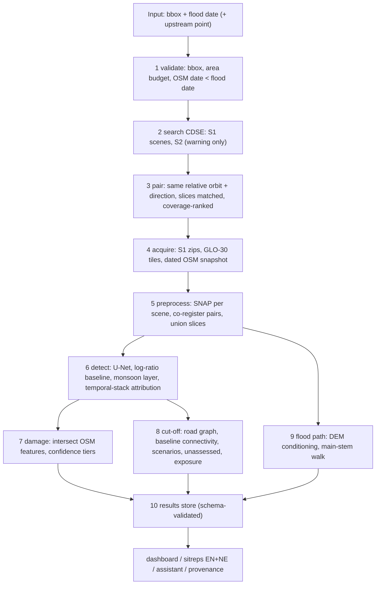

# FloodSight Architecture

Purpose and scope: this document describes the system AS DELIVERED -
every module, the runtime workflow, the detection and analysis design
with where each threshold came from, the CLI in depth, measured
performance, validation methodology, and an index of the recorded
decisions. It is the reference for maintainers; README.md is the
judge/user entry point. The system answers: where did the flood hit,
what was damaged, who is cut off - for any bbox and flood date, from
raw Sentinel-1 radar, the Copernicus GLO-30 DEM and a pre-event OSM
snapshot, under hackathon data rules.

## Plan vs delivered

| Planned item | Status | Reason / evidence |
|---|---|---|
| Sentinel-2 optical confirmation of radar detections | STOPPED | evaluated on real scenes: post-event passes 40-86% cloud, joint cloud-free observability 15.4%, control NDVI null at z=-21 from cloud-edge noise, zero scars in reference AOIs (D81); radar-only operation is the designed fallback |
| OSM via ohsome API (date-pinned) | REPLACED | ohsome service degraded/blocked during development (D19); Geofabrik dated extract nepal-260701.osm.pbf (state 2026-07-01, md5-verified) with startup enforcement that the snapshot date is strictly pre-event |
| Copernicus DEM acquisition | DELIVERED (variant) | GLO-30 tiles fetched via the AWS bucket path (D-series); tiles cached under data/raw/dem |
| U-Net encoder ResNet-50 | DELIVERED as ResNet-18 | CPU-only training budget (no GPU); ResNet-18 trained in ~73 s/epoch x 15 epochs; ImageNet-pretrained v2 tested and REJECTED on held-out test (0.4526 vs 0.6300, D78) |
| Situational copilot with pluggable LLM | DELIVERED template-only | reports and assistant work with NO LLM and NO API key; the LLM hook exists but every number is validator-checked against the results store regardless |
| Server-side processing (openEO) vs SNAP | SNAP DELIVERED | openEO was evaluated and rejected early (D28); ESA SNAP 14.0.0 headless (gpt) does orbit/thermal/calibration/Lee/TC at 10 m; cached per scene pair incl. co-registration (D72) |
| Cut-off analysis two scenarios (likely/possible) | DELIVERED + third category | v2 adds "unassessed" for settlements whose routes cross terrain masked as radar-unreliable (483 of 594 v1-connected, D77) |
| Debris "evidence layer" | SPLIT into two labelled layers | controls showed the single-pair layer detects monsoon change on every date (D54/D66); it is retained as "other ground change" and a temporal-stack event-attributed layer was added (0.455 km2, ratios 4.69/3.07, D66/D75) |
| Flood path bonus | DELIVERED | main-stem walk on the conditioned DEM from the user-verified upstream point; 189.4 km traced, within 4% of OSM centrelines |

## Layered architecture

## Runtime workflow

1. **Validate input** - bbox order and size (soft warning above the
   configured side threshold), date, OSM snapshot strictly earlier
   than the flood date (hard stop), judge-mode area budget (hard stop
   before any download). Output: `stage_status.json` entry.
2. **Cache check** - every stage is resumable; a completed stage for
   the same key is not re-run (pair-level SNAP cache includes the
   co-registration, D72, so cached areas open in minutes).
3. **Search Sentinel-1** - CDSE OData; scenes grouped into track
   passes; sparse-scene warning if few.
4. **Pair** - same relative orbit + flight direction only; slices
   matched by slice number; ranked by coverage and date proximity;
   "no valid same-track pair" is a legitimate stopping result with the
   nearest alternatives listed (verified 2026-10-12, D60).
5. **Search Sentinel-2** - recorded as a warning channel only for this
   event (optical stopped, D81).
6. **Fetch DEM + OSM** - GLO-30 tiles cached; OSM from the dated
   Geofabrik snapshot, extracted per run into `osm/`.
7. **Preprocess** - SNAP graph per scene: Read -> Subset(bbox) ->
   Apply-Orbit-File -> ThermalNoiseRemoval -> Calibration(sigma0) ->
   Speckle-Filter(Lee 3x3) -> Terrain-Correction(GLO-30, 10 m UTM) ->
   BandSelect; pairs co-registered (bilinear) onto the pre grid;
   multi-slice passes unioned on a corridor grid with per-track
   attribution. Failure: visible error, dependent stages skipped with
   reasons.
8. **Detect** - per co-registered slice: U-Net inference (overlapping
   tiles, averaged overlaps, min-blob filter), log-ratio Otsu
   baseline (dark-water subtraction, DEM slope and incidence
   validity), monsoon change layer, and - in attribution mode - the
   temporal-stack z-scores. Union on the common grid; analysed area =
   valid pixels; partial-coverage warning below 90%.
9. **Damage** - OSM features clipped to the analysed area (grid-
   subdivided sjoin, D68); tiers from mapped-layer confidence;
   bridges flagged when their 50 m approach buffer intersects a
   flagged zone (approach wording, D76).
10. **Cut-off** - road graph from the pre-event snapshot; baseline
    connectivity first (already-isolated reported separately); two
    flood scenarios; v2 unassessed category; detour lengths; evidence
    per settlement (failed segments).
11. **Flood path (optional upstream point / full mode)** - priority-
    flood conditioning, D8 routing, main-stem walk, corridor buffer
    growing with accumulation; settlements listed along it.
12. **Write results** - `results.json` (schema-validated), rasters,
    vectors, provenance, warnings; then the dashboard/CLI read only
    the store.

Failure behaviour everywhere: a failed stage marks itself in
`stage_status.json`, dependent stages are skipped with reasons, and
partial outputs are labelled partial - never silently completed.

## Module reference

| Module | Purpose | Key inputs -> outputs |
|---|---|---|
| `cli.py` | thin entry: run/dashboard/report/train/evaluate | args -> pipeline call |
| `pipeline.py` | orchestration, caching, stages, warnings | bbox/date -> run folder |
| `config.py` | config + .env loading, validation | yaml/.env -> cfg dict |
| `provenance.py` | scene/date/orbit/OSM/model provenance | run -> provenance.json |
| `acquisition/cdse_client.py` | OData search, token, resumable download with partial-file guard (D59) | query -> products/zips |
| `acquisition/orbit_pairing.py` | same-track pairing, slice matching, coverage ranking | scenes -> PairResult |
| `acquisition/dem.py` | GLO-30 tile fetch/cache | bbox -> tiles |
| `acquisition/osm_snapshot.py` | dated snapshot extraction (buildings, roads, bridges, settlements, destinations, waterways) | pbf -> osm/*.geojson |
| `preprocessing/s1.py` | SNAP graph builder/runner, atomic co-registration, pair cache | zips -> TC rasters |
| `preprocessing/dem_derivatives.py` | fill, flow, accumulation, HAND (fast + slow), slope | DEM -> derivatives |
| `preprocessing/masks.py` | shadow/layover/no-data masks | rasters -> masks |
| `detection/model.py` | U-Net definition, checkpoint load, tiled inference | rasters -> water mask |
| `detection/baseline.py` | log-ratio Otsu + vectorisation (8-connectivity) | pair -> flood vectors |
| `detection/debris.py` | monsoon change layer (+3 dB, not-water, slope, waterway buffer) | pair -> layer |
| `detection/temporal_stack.py` | stack alignment, median/MAD, robust z (windowed, full-width bands after the TIFF strip-append bug, D66) | stack -> z rasters |
| `analysis/damage.py` | tiered damage, bridge approach rule, fast analysed-area clip | layers+OSM -> damage |
| `analysis/cutoff.py` | graph, connectivity, scenarios, evidence | OSM+layers -> cutoff |
| `analysis/flood_path.py` | DEM routing + corridor + settlements | upstream -> path |
| `reporting/results_store.py` | schema-validated single source of truth | dict -> results.json |
| `reporting/sitrep.py` | EN/NE one-pagers, number-grounded (validator), PDF | run -> sitreps |
| `reporting/validator.py` | collects every grounded number (incl. list lengths) and rejects ungrounded ones | text+store -> ok/refuse |
| `reporting/assistant.py` | grounded Q&A over the store | question -> answer |
| `dashboard/app.py` | dark UI, Esri satellite basemap full-width, v2 panels, detached run launcher | run folder -> UI |
| `training/train.py` | CPU training loop (out-tag guard protects v1) | npz caches -> checkpoint |
| `training/prepare_kurosiwo.py` | event-wise splits from the webdataset manifest | shards -> caches + manifest |
| `evaluation/*` | every validation: segmentation (by event/terrain), controls, placebo, EMSR927 one-shot, circularity, counts, terrain honesty, optical (stopped), coverage breakdown | results -> evaluation/results/*.json |

## Detection design and thresholds

- **Model v1** - U-Net, ResNet-18 encoder, 7 channels (post/pre VV/VH,
  DEM, slope, VV diff), event-wise splits (19/5/6), 15 epochs on CPU;
  best validation flood IoU 0.3229 (oscillating - reported as-is).
- **Baseline** - post-pre log-ratio, Otsu per slice (case study:
  -0.53 dB and the second slice's threshold in detection.json),
  dark-water dB -17.0, permanent-water subtraction, min-blob 20 px.
- **Monsoon layer ("other ground change")** - brightening >= +3 dB,
  not-water, slope <= 30 deg, within 1 km of mapped waterways;
  thresholds from config, grounded in the pair evidence; relabelled
  after controls (D54).
- **Event-attributed layer** - 5-scene pre-event stack, per-pixel VV
  median/MAD in dB, robust z of the post scene, threshold = control
  distribution p99.9 (z=4.679; from CONTROLS ONLY, never the
  reference), valley floor = HAND <= 25 m, slope <= 15 deg, within
  2 km of the main stems. Ratios: 4.69 (control a), 3.07 (independent
  control d), leave-one-out 0.116-0.200 km2 (D75).
- **HAND** - vectorised nearest-drainage variant (validated vs the
  flow-walk: mean abs diff 3.35 m in the valley-floor regime, D61).
- **Freeze protocol** - before the one-shot EMSR927 comparison the
  state was frozen and hashed (D69): config sha256 b09870f7...bc1bb
  over config/**/*.yaml, source sha256 ba55a74a...3c00 over
  src/floodsight/**/*.py; 104 tests + lint clean at freeze; the
  comparison ran once; every later change is labelled in DECISIONS.md
  (D71-D83).

## Damage and cut-off logic

- **Tiers** - mapped-layer confidence >= 0.6 likely, >= 0.3 possible;
  the attribution maps its control percentiles onto that scale
  (0.8 = p99.99 likely, 0.5 = p99.9 possible, D68).
- **Buildings** - headline = centroid inside the event-attributed
  union (30); secondary = footprint-touching tiers (8/74); the
  definitions live side by side in evaluation/results/v3_counts.json.
- **Bridges** - flagged when the 50 m approach buffer intersects a
  flagged zone; wording everywhere: "approach inside the flagged zone;
  no bridge observed damaged" (0 m direct overlap, D76).
- **Cut-off v1** - baseline connectivity, likely/possible scenarios,
  detours, evidence. **v2** - adds *unassessed* (route > 5 m outside
  the analysed area): 483 of 594 v1-connected settlements; 111
  verifiably connected; totals reconcile to 899 (D77).
- **Terrain exposure scenario** - settlements/roads/bridges inside
  the flood-path corridor AND the valley-floor domain, always labelled
  **NOT observed damage** (17 / 1,184.2 km / 137).

## Flood path

Priority-flood conditioned DEM, D8 flow, nearest-drainage snap,
main-stem walk from the user-verified upstream point (85.377, 28.278);
corridor buffer grows with accumulation; 189.4 km traced, within 4% of
the OSM centrelines for the same stretch; labelled a terrain-based
hazard corridor, not a hydraulic simulation.

## Results schema and run folder

`results.json` carries meta / inputs / flood / damage / cutoff /
flood_path / warnings, validated on write and read; unknowns are null,
never 0. The run folder contents are tabulated in README.md ("Run
folder files").

## Dashboard, report and assistant design

- **Dashboard** - dark operational theme (Geist + JetBrains Mono,
  tabular numerals); Esri World Imagery full-width map with an Esri
  labels overlay (no API keys); layers toggled via folium controls;
  Streamlit-side legend chips; quality badges (analysed area vs raw
  coverage, event/control ratio); v2 unassessed + exposure panels;
  run launcher detached (own process group) with live stage chips;
  honest empty/error/no-pair states.
- **Sitrep** - EN/NE markdown + PDF from templates with a fixed Nepali
  glossary; every number validator-checked (the validator also
  grounds list lengths after D-sitrep fix); "not in the analysis"
  answers; no LLM required.
- **Assistant** - lookup functions over the store only; validator runs
  on every answer; speculates never about casualties.

## CLI in depth (verified against `floodsight --help`)

- `floodsight run (--bbox LON_MIN LAT_MIN LON_MAX LAT_MAX | --region
  REGION) [--date YYYY-MM-DD] [--mode fast|full] [--upstream LON LAT]
  [--judge]` - runs all stages; `--judge` enforces
  `judge.max_area_km2` (500) before any download; `--region` uses
  config/regions/*.yaml (bbox/date/upstream from the preset, `--date`
  overrides); exit 0 success, 2 input/config error, 3 unimplemented;
  stages cache by key, a failed stage is visible and dependents skip.
- `floodsight dashboard` - starts Streamlit on :8520.
- `floodsight report --run RUN [--lang en,ne]` - sitreps from the
  store; refuses ungrounded numbers.
- `floodsight train [--config]` / `floodsight evaluate
  {segmentation,emsr927,assistant} [--checkpoint] [--run]
  [--reference]` - CLI stubs that point at the real scripts
  (training/train.py, evaluation/*.py) - deliberate, documented.
- **Modes** - `fast`: one radar pair (quick mode, ~14 min on a 415
  km2 box, labelled monsoon-baseline change, NOT event-attributed);
  `full`: adds the flood path; **event attribution** is the temporal
  stack path (evaluation/ scripts + dashboard layer), ~46 min on the
  judge box (D79) - measured, not promised.

## Performance and scaling (measured only)

| Operation | Measured |
|---|---|
| Fresh 415 km2 quick-mode run (downloads included) | 23.4 min (D67) |
| Cached pair re-open (case study) | minutes (D72) |
| Detection, damage, cut-off (415 km2) | 17 s / 11 s / 5 s |
| Corridor case study (9,237 km2, 4 SNAP scenes) | ~104 min |
| Parallel downloads (2 x 1.73 GB) | 318.9 s, 10.88 MB/s |
| Parallel SNAP (2 scenes, -q 4) | 242.3 s |
| Training (15 epochs, 8 vCPU) | ~73 s/epoch |
| Full attribution estimate (judge box) | ~46 min |

GPU would not help materially: wall time is downloads + SNAP I/O, not
inference (17 s CPU).

## Validation methodology and results

- Controls at identical code/thresholds (old layer): event 41.99 km2,
  pre-event 54.25 km2, post-recession 30.87 km2, current-date honest
  refusal; attribution (new method): event 0.455 km2 vs controls 0.097
  / 0.148 / LOO 0.116-0.200 - ratios 4.69 / 3.07 (D54, D60, D66, D75).
- Placebo vs EMSR927 at 0/30/100 m: non-event layers F1 up to 0.59 >
  event layer 0.47 at 100 m; random placement 0.034; prevalence 28.3%
  (D74/D80).
- EMSR927 one-shot (post-freeze, no tuning): reference is mass
  movement; precision 0.659/0.694/0.762, recall 0.013/0.093/0.343;
  building recall 9/3,807 (0.24%); 5 misses + 5 false alarms exported
  (D70).
- AI: v1 vs v2 vs baseline, val and test, per-event and per-bin, with
  leakage check; no held-out event is mountainous (D63, D78).
- Optical: evaluated and stopped with numbers (D81).
- Coverage truth: raw footprint 99.9%, analysed 55.9% after terrain
  masks (slope>30 deg 43.85%, layover 0.37%) - reproduced by a script
  (D58).

## Key decisions index

D5 COG duplicates skipped - D7 live API fields - D18 agent never
commits - D19 Geofabrik over ohsome - D28 SNAP over openEO - D29 SNAP
band order - D32 debris evidence grounding - D38 model vs baseline
held-out - D42 Koshi rehearsal - D44 run.sh - D46 slice matching -
D50 vectorisation stalls fixed - D51 CRS/confidence bugs - D52 cache
collision fixed - D53 v1 freeze - D54 control-a result - D55 basemap
fix - D59 partial-download guard - D60 honest no-pair - D61 fast HAND
validation - D62 judge mode + box - D63 AI evidence - D64 EMSR927
acquired - D65 shard cleanup - D66 attribution result - D67 judge
timing - D68 recompute - D69 freeze - D70 one-shot comparison - D71
labelled post-comparison fix - D72 dashboard/launcher repair - D73
weights plan - D74 placebo - D75 circularity/LOO - D76 counts/bridges
- D77 unassessed + exposure - D78 ImageNet rejected - D79 modes -
D80 placebo fix - D81 optical stop - D82 round-5 hash - D83 final
polish (Esri-only basemaps, release SHA-256).

## Limitations and future work

From measured evidence: no standing water demonstrated on this event;
radar change cannot grade per-building damage; 43.85% of the corridor
is masked and 483 settlements are unassessed; the kept model's test
score is an optimistic selection and validation underperforms the
baseline; no mountainous held-out event; the event layer trades
recall for precision; optical confirmation impossible in monsoon.
Future work: windowed stack statistics to cut attribution time;
GPU-or-more-data training with stable validation; an SCL-cloud optical
scar path for post-monsoon re-acquisitions; vectorised HAND beyond the
valley-floor regime; damage grading from VHR optical.
